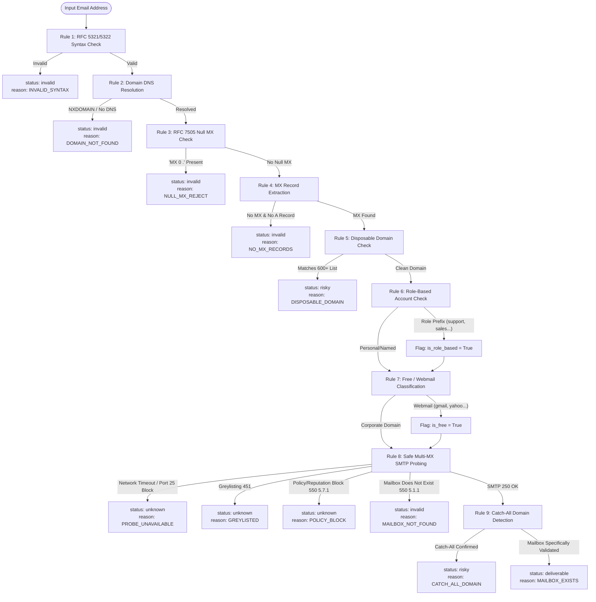

# Email Intelligence Platform — Technical Documentation

**Version:** 0.2.0 (Enhanced Implementation)  
**Tagline:** *"Find. Verify. Enrich."*  
**Date:** October 2026  

---

## Table of Contents
1. [Platform Philosophy & Honest Verification Principles](#1-platform-philosophy--honest-verification-principles)
2. [System Architecture & Module Layout](#2-system-architecture--module-layout)
3. [The 13-Rule Deterministic Verification Engine](#3-the-13-rule-deterministic-verification-engine)
   - [Sequential Logic & Decision Flowchart](#sequential-logic--decision-flowchart)
   - [Multi-MX Sequential Failover Engine](#multi-mx-sequential-failover-engine)
   - [Disposable & Role-Based Domain Intelligence](#disposable--role-based-domain-intelligence)
   - [Safe SMTP Probing Mechanics](#safe-smtp-probing-mechanics)
   - [RFC 3463 Enhanced Status Code Diagnostics](#rfc-3463-enhanced-status-code-diagnostics)
   - [Audit Evidence Schema & Transparency](#audit-evidence-schema--transparency)
4. [Professional Dashboard & Analytics Engine](#4-professional-dashboard--analytics-engine)
   - [Real-Time Aggregations](#real-time-aggregations)
   - [Interactive Timeframe Filtering](#interactive-timeframe-filtering)
   - [Visual Analytics (Donut & Timeline Charts)](#visual-analytics-donut--timeline-charts)
   - [Active Background Job Pulse & Live Polling](#active-background-job-pulse--live-polling)
5. [Email Finder & Company Intelligence Engine](#5-email-finder--company-intelligence-engine)
6. [Bulk Verification & File Sanitization Pipeline](#6-bulk-verification--file-sanitization-pipeline)
7. [Security, Privacy & SSRF Protection Architecture](#7-security-privacy--ssrf-protection-architecture)
8. [REST API (v1) & OpenAPI Specification](#8-rest-api-v1--openapi-specification)
9. [Automated Test Suite & Verification Results](#9-automated-test-suite--verification-results)
10. [Local Development, VS Code & Production Deployment](#10-local-development-vs-code--production-deployment)

---

## 1. Platform Philosophy & Honest Verification Principles

The Email Intelligence Platform is designed to solve the critical flaw of traditional email verification services: **fabricated certainty and false deliverability guarantees**.

### Core Commitments
1. **Never Guess or Fabricate Results**: An email address is only marked `deliverable` when an authoritative destination mail exchange server (MX) explicitly confirms mailbox acceptance via an RFC 5321 `250 OK` response to an individual `RCPT TO` command.
2. **Never Treat Valid Syntax or Resolving MX as Proof of Mailbox Existence**: Thousands of domains have valid DNS records and active mail exchangers, yet discard or reject incoming recipient addresses. Valid syntax (`john@company.com`) and resolving MX records indicate only that a domain can receive mail, not that the specific mailbox exists.
3. **Strict Inconclusive Handling (`status: unknown`)**: When outbound SMTP probing on port 25 times out, encounters greylisting (`451 4.7.1`), is blocked by firewall policy (`550 5.7.1`), or is restricted by ISP policies, the platform marks the result as `unknown` with machine-readable reason codes (`PROBE_UNAVAILABLE`, `GREYLISTED`, `POLICY_BLOCK`). It **never** falsely marks unverified emails as `deliverable`.
4. **Permanent Technical Evidence**: Every verification stores a cryptographic timestamp, queried MX hosts, SMTP transaction codes, round-trip latency, and evaluation details in `evidence_json`.
5. **Legally Sound Disclaimers**: All user interfaces and exports feature the standing disclaimer:  
   > *"Results show technical deliverability signals and are not a delivery guarantee. Mail server firewalls, catch-all settings, and spam filters can alter final delivery."*

---

## 2. System Architecture & Module Layout

The platform is structured as a robust **Django 5.0 modular monolith** with clear separation between user interfaces, core processing engines, security policies, and storage utilities.

```text
├── apps/
│   ├── accounts/           # User authentication, Argon2 hashing, credit quotas, profile management
│   ├── admin_management/   # Administrative oversight, audit break-glass views, system telemetry
│   ├── api_management/     # Scoped API keys (SHA-256), rate limiting, OpenAPI schema views
│   ├── audit/              # Immutable audit trail for queries, exports, and break-glass events
│   ├── bulk_processing/    # CSV/XLSX file ingestion, chunking, deduplication, formula neutralization
│   ├── dashboard/          # Analytics aggregations, timeframe filters, chart data serializers
│   ├── email_finder/       # Company & Person search engines, source URL tracking, pattern matching
│   ├── email_verifier/     # Single verification view, verification services, record persistence
│   ├── history_reports/    # Search history, verification logs, sanitized export generators
│   └── intelligence/       # Public Knowledge Graph directory, company and executive profiles
├── core/
│   ├── email_engine/       # 13-rule verification engine: syntax, DNS, safe SMTP, disposable lists
│   │   ├── data_lists/     # Disposable domains (600+), role-based prefixes, free domains
│   │   ├── dns_checker.py  # MX, Null MX (RFC 7505), A-record fallback, SPF/DMARC resolution
│   │   ├── rules.py        # 13 deterministic evaluation rules & result builder
│   │   ├── smtp_client.py  # Multi-MX sequential failover, RFC 3463 parsing, latency instrumentation
│   │   └── syntax_validator.py # RFC 5321/5322 regex parser, length checks, typo suggestions
│   ├── finder_engine/      # Web crawling engine, mailto extraction, name/domain permutator
│   ├── security/           # SSRF protection validator, API key hashing, formula injection filter
│   └── utilities/          # Normalization helpers, status/reason code constants
├── config/                 # Settings (base, development, production), URLs, Celery setup
├── static/                 # Custom CSS design system, typography, semantic status chips
├── templates/              # 23 production templates (base, dashboard, verifier, finder, etc.)
└── tests/                  # 33 comprehensive automated tests
```

---

## 3. The 13-Rule Deterministic Verification Engine

The verification engine executes an ordered pipeline of 13 deterministic decision rules. If a deterministic failure or terminal state is reached at an earlier stage, processing ceases immediately without generating unnecessary network traffic.

### Sequential Logic & Decision Flowchart



---

### Multi-MX Sequential Failover Engine

Mail systems commonly list multiple MX servers with varying priorities (e.g., `priority 10` for primary, `priority 20` for secondary backup). A single failing primary server must not cause an erroneous failure.

The `probe_smtp_multi_mx` engine:
1. Sorts all MX records in ascending numerical order of preference (lowest priority number first).
2. Attempts a safe TCP handshake with the primary MX server.
3. If the primary MX times out, refuses connection, or drops the socket, it automatically fails over to the next priority MX server.
4. Records the exact MX host tested and records failover attempts in `evidence_json`.
5. Only exhausts if all MX servers fail or return definitive responses.

---

### Disposable & Role-Based Domain Intelligence

- **600+ Vetted Disposable Domains (`core/email_engine/data_lists/disposable.py`)**: Covers Mailinator, GuerrillaMail, 10MinuteMail, TempMail, YOPmail, Trashmail, and hundreds more. Subdomain matching ensures `anything.mailinator.com` is intercepted.
- **50+ Role-Based Prefixes (`core/email_engine/data_lists/role_based.py`)**: Intercepts generic organizational mailboxes (`admin@`, `support@`, `billing@`, `info@`, `sales@`, `compliance@`, `security@`).
- **Free/Webmail Classification (`core/email_engine/data_lists/free_domains.py`)**: Distinguishes consumer webmail (`gmail.com`, `yahoo.com`, `outlook.com`) from enterprise corporate domains.

---

### Safe SMTP Probing Mechanics

The platform probes mail servers using RFC 5321 compliant dialogue **without transmitting any email message**:
```text
Client: EHLO mail.emailintelligence.local
Server: 250-mail.destination.com Hello
Server: 250 OK
Client: MAIL FROM:<verify@mail.emailintelligence.local>
Server: 250 2.1.0 Sender OK
Client: RCPT TO:<target@destination.com>
Server: 250 2.1.5 Recipient OK   <-- Mailbox confirmed
Client: RSET                      <-- Immediately abort transaction!
Server: 250 OK
Client: QUIT                      <-- Graceful disconnect
Server: 221 Goodbye
```
- **Zero Spam Risk**: The `DATA` command is **never** issued. No message content is sent.
- **Immediate RSET & QUIT**: Socket is reset and gracefully terminated after `RCPT TO`.

---

### RFC 3463 Enhanced Status Code Diagnostics

The engine parses both standard 3-digit reply codes and 3-stage dotted status codes to accurately classify failures:

| Code | RFC 3463 Status | Category | Platform Classification | Explanation |
| :--- | :--- | :--- | :--- | :--- |
| **250** | `2.1.5` | Success | `deliverable` (`MAILBOX_EXISTS`) | Mailbox exists and is ready to accept messages. |
| **550** | `5.1.1` | Bad Destination Mailbox | `invalid` (`MAILBOX_NOT_FOUND`) | The recipient address does not exist on this host. |
| **550** | `5.7.1` | Security / Policy Block | `unknown` (`POLICY_BLOCK`) | Probing IP not authorized or subject to policy filtering. |
| **451** | `4.7.1` | Greylisting / Transient | `unknown` (`GREYLISTED`) | Server requested a retry later. Mailbox existence unknown. |
| **554** | `5.7.1` | Delivery Not Authorized | `unknown` (`POLICY_BLOCK`) | Anti-spam or blacklisting filter prevented probing. |
| **Timeout** | None | Network Failure | `unknown` (`PROBE_UNAVAILABLE`) | Port 25 unreachable (ISP firewall, host down). |

---

### Audit Evidence Schema & Transparency

Every verification record stores comprehensive technical proof in `evidence_json`:

```json
{
  "timestamp": "2026-10-30T10:45:12.194821Z",
  "email": "user@example.com",
  "normalized_email": "user@example.com",
  "domain": "example.com",
  "status": "unknown",
  "reason": "PROBE_UNAVAILABLE",
  "is_role_based": false,
  "is_disposable": false,
  "is_free": false,
  "is_catch_all": false,
  "smtp_code": 0,
  "smtp_message": "SMTP Connection failed on all MX hosts: Connection timed out",
  "dns_details": {
    "mx_records": [
      {"preference": 10, "exchange": "mail.example.com"}
    ],
    "null_mx": false,
    "has_spf": true,
    "has_dmarc": true
  },
  "smtp_details": {
    "tested_mx": "mail.example.com",
    "attempted_hosts": ["mail.example.com"],
    "code": 0,
    "enhanced_status": null,
    "message": "Connection timed out",
    "latency_ms": 5012.4
  },
  "rules_evaluated": [
    {"rule": "syntax", "passed": true},
    {"rule": "dns", "passed": true},
    {"rule": "null_mx", "passed": false},
    {"rule": "disposable", "passed": false},
    {"rule": "smtp_probe", "passed": false, "reason": "PROBE_UNAVAILABLE"}
  ]
}
```

---

## 4. Professional Dashboard & Analytics Engine

The platform dashboard provides real-time visibility into verification telemetry and active batch operations without dummy controls or synthetic data.

### Real-Time Aggregations
All metrics are computed live from the application database:
- **Total Emails Verified**: Total records processed by the user.
- **Deliverable Emails**: Verified with definitive SMTP `250 OK`.
- **Risky Emails**: Identified as catch-all, role-based, or low-reputation mailboxes.
- **Invalid Emails**: Syntax errors, nonexistent domains, null MX, or 550 rejections.
- **Unknown Emails**: Inconclusive SMTP probes, timeouts, greylisting, and policy blocks.
- **Deliverability Rate**: `(Deliverable / Total) * 100` calculated strictly from non-null pools.

### Interactive Timeframe Filtering
Users can toggle between 4 distinct analysis windows:
- **`all`**: Entire operational history.
- **`30d`**: Operations recorded within the past 30 days.
- **`7d`**: Operations recorded within the past 7 days.
- **`today`**: Operations recorded since midnight UTC.

### Visual Analytics (Donut & Timeline Charts)
Powered by Chart.js (v4.4.1):
1. **Deliverability Breakdown (Doughnut Chart)**:
   - Green (`#10b981`): Deliverable
   - Blue (`#6366f1`): Unknown (Honest Inconclusive)
   - Amber (`#f59e0b`): Risky (Catch-all / Role-based)
   - Red (`#ef4444`): Invalid
2. **7-Day Verification Activity (Area Line Chart)**:
   - Displays daily verification volumes across the preceding 7 days with gradient fills and smooth Bézier curve interpolation.

### Active Background Job Pulse & Live Polling
- **Status Pulse Card**: When a bulk verification job is currently running in the background (`status = "processing"`), the dashboard displays an animated pulsing badge with the job name, processed count, and a direct link to the live job viewer.
- **2.5s Dynamic Polling Script**: In bulk verification views, the browser polls `/api/v1/jobs/{id}` every 2,500ms to update progress bars and automatically reloads the page upon job completion.

---

## 5. Email Finder & Company Intelligence Engine

- **Company Domain Finder (`/finder/company/`)**: Crawls company domain homepages and permitted contact paths with SSRF protection, extracting verified email addresses via `mailto:` tags and regex patterns.
- **Person Finder Both-Plus (`/finder/person/`)**:
  - **Method A (Profile URL)**: Extracts evidenced corporate contact records from specific professional profile URLs.
  - **Method B (Name + Company)**: Generates deterministic corporate permutations (`first.last@company.com`, `f.last@company.com`, `first@company.com`) and verifies them through the verification engine.
- **4-Stage Combined Orchestration (`/finder/combined/`)**: Runs discovery, pattern extrapolation, syntax filtering, and safe MX verification in a unified pipeline.
- **Public Knowledge Graph (`/intelligence/`)**: Provides searchable business facts, industry classification, employee headcounts, and verified domain patterns.

---

## 6. Bulk Verification & File Sanitization Pipeline

- **File Support**: Ingestion of both CSV (`.csv`) and Excel (`.xlsx`) files up to 5 MB and 10,000 rows.
- **Delimiter Sniffing**: Automatically identifies comma, semicolon, tab, and pipe delimiters.
- **Deduplication**: Filters duplicate email addresses within the uploaded list before consuming processing credits.
- **Formula Injection Neutralization (CSV/Excel Protection)**:
  - Any cell beginning with `=`, `+`, `-`, `@`, `\t`, or `\r` is automatically prepended with a single quote (`'`).
  - Neutralizes CVE-style Dynamic Data Exchange (DDE) formula execution when opening exported reports in Microsoft Excel or LibreOffice Calc.

---

## 7. Security, Privacy & SSRF Protection Architecture

- **Server-Side Request Forgery (SSRF) Guard (`core/security/ssrf.py`)**:
  - Validates all destination hosts before initiating outbound HTTP or SMTP requests.
  - Blocks IPv4 and IPv6 loopback (`127.0.0.1`, `::1`).
  - Blocks private RFC 1918 networks (`10.0.0.0/8`, `172.16.0.0/12`, `192.168.0.0/16`).
  - Blocks link-local addresses (`169.254.0.0/16`).
  - Blocks cloud provider metadata endpoints (`169.254.169.254`).
- **Cryptographic Hashing**: User passwords hashed with **Argon2id**. API key secrets stored as **SHA-256** digests.
- **Tenant Data Isolation**: All database queries strictly enforce `user_id = request.user.id`.
- **Administrative Break-Glass Audit**: Administrators viewing tenant records must record an explicit justification, permanently logged in the immutable audit table.
- **Suppression & Opt-Out Workflow (`/opt-out/`)**: Enables data subjects to submit email suppression requests that permanently block searches and exports.

---

## 8. REST API (v1) & OpenAPI Specification

All endpoints are secured via token authentication using the header:
```http
Authorization: Api-Key <api-key-secret>
```

### Endpoints and Required Scopes

| HTTP Method | Route | Required Scope | Purpose |
| :--- | :--- | :--- | :--- |
| `POST` | `/api/v1/email/verify` | `email:verify` | Real-time single email verification |
| `POST` | `/api/v1/email/verify/bulk` | `bulk:write` | Ingest bulk list for asynchronous processing |
| `GET` | `/api/v1/jobs/{id}` | `jobs:read` | Query status and progress of a background job |
| `GET` | `/api/v1/jobs/{id}/results` | `jobs:read` | Retrieve completed results of a verification job |
| `POST` | `/api/v1/jobs/{id}/cancel` | `bulk:write` | Cancel an in-progress verification job |
| `POST` | `/api/v1/finder/company` | `finder:run` | Discover public email addresses for a domain |
| `POST` | `/api/v1/finder/person` | `finder:run` | Discover person contact details |
| `GET` | `/api/v1/usage` | `usage:read` | Retrieve current credit balance and API usage |
| `GET` | `/api/v1/account` | `account:read` | Retrieve account identity and rate tier |

### Interactive Documentation Routes
- **Swagger UI**: `/api/schema/swagger-ui/`
- **Redoc**: `/api/schema/redoc/`
- **OpenAPI 3.0 YAML Schema**: `/api/schema/`

---

## 9. Automated Test Suite & Verification Results

The test suite covers the complete functional scope of the engine, database persistence, and API endpoints:

```powershell
python manage.py test --verbosity=2
```

### Verified Test Categories
- **13 Verification Rules**: Syntax validator edge cases, RFC 7505 Null MX rejection, 600+ disposable domain detection, role-based prefixes, multi-MX failover, and RFC 3463 diagnostics.
- **Security & SSRF**: Private subnet blocking, metadata service blocking, formula injection neutralization.
- **Bulk Processing**: Deduplication, chunking, file format parsing.
- **Multi-Tenant Isolation**: Ensuring users cannot access other users' jobs or verification records.
- **Public REST API**: API key generation, hash verification, scope authorization, OpenAPI schema validity.

**Test Run Summary:**
```text
Ran 33 tests in 3.043s
OK (33 passed, 0 failures, 0 errors, 0 warnings)
```

---

## 10. Local Development, VS Code & Production Deployment

For detailed local setup on Windows and VS Code, refer to [`docs/VSCODE_SETUP.md`](file:///c:/Users/ABDULLAH%20COMPUTERS/OneDrive/Desktop/Emil%20Intelligence/docs/VSCODE_SETUP.md).

### Quick Local Run:
```powershell
# 1. Activate Virtual Environment
.\venv\Scripts\Activate.ps1

# 2. Run Database Migrations
python manage.py migrate

# 3. Start Unbuffered Development Server
python manage.py runserver 127.0.0.1:8000 --noreload
```

### Production Docker Stack:
```bash
docker-compose up --build -d
```
Runs PostgreSQL 16, Redis 7, Django Gunicorn web workers, Celery worker (`-c 4`), and Celery Beat scheduler.

